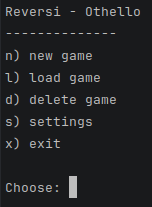
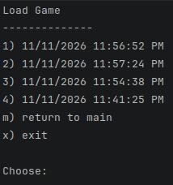
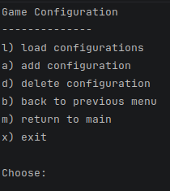
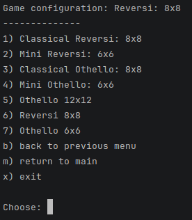
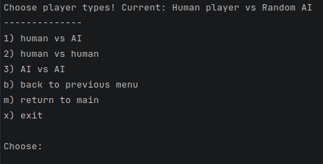
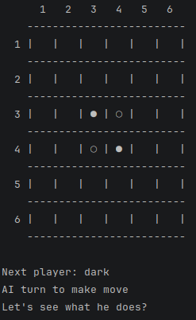
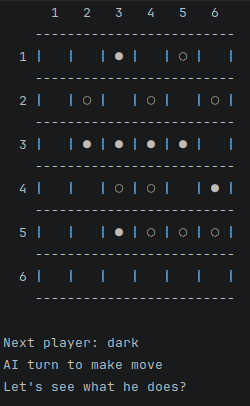

# README
## Author and project info
Name: Aimar Tuul  
student code: 266685TAI  
uni-id: aituul  
assigned game: reversi-othello  

## Screenshots

### Menu






### Gameplay



## EF Core migrations commands
```bash
# install and update commands
dotnet tool install --global dotnet-ef
dotnet tool update --global dotnet-ef       # later
dotnet ef --version

# add migration called "InitialCreate" 
dotnet ef migrations add InitialCreate --project DAL --startup-project ConsoleApp

# apply migrations
dotnet ef database update --project DAL --startup-project ConsoleApp

# list, remove migrations or drop database
dotnet ef migrations list --project DAL --startup-project ConsoleApp
dotnet ef migrations remove --project DAL --startup-project ConsoleApp         # delete the last migration, if it is not applied yet
dotnet ef database drop --project DAL --startup-project ConsoleApp             # delete the database file — cheap during development
```

## Nuget packages
```bash
# in DAL
Microsoft.EntityFrameworkCore.Sqlite

# in ConsoleApp
Microsoft.EntityFrameworkCore.Design
```